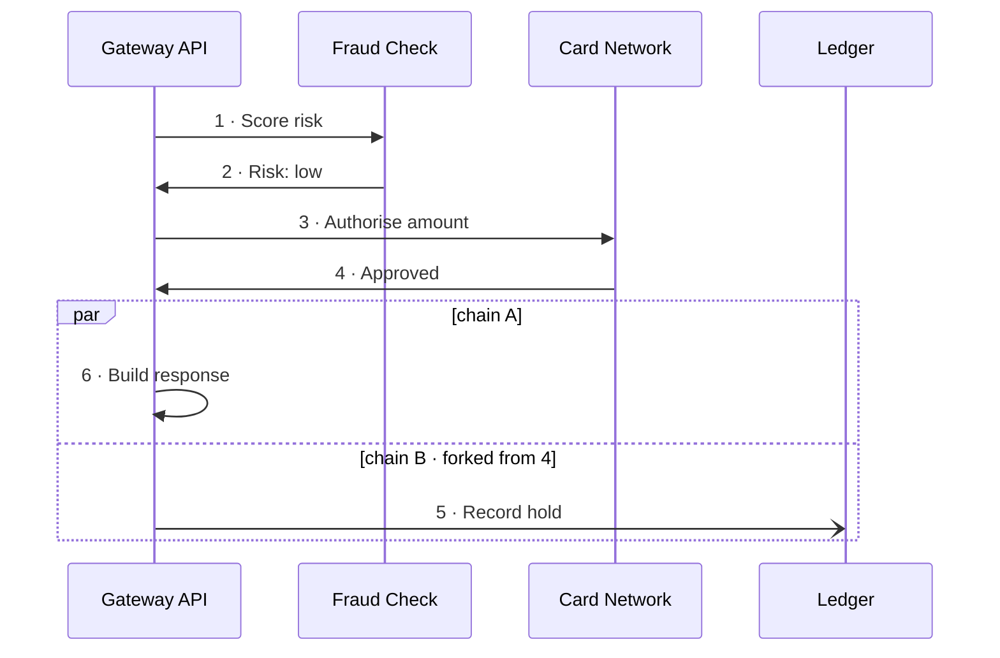
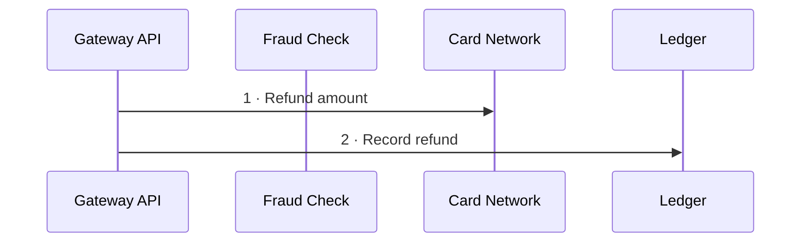

# Acme payments

```system
slug: acme-payments
label: Acme payments
fill: '#e5dbff'
opacity: 0.6
selfReach: 0.35
```

## Participant: Gateway API

```participant
slug: gateway-api
kind: service
fill: '#d0bfff'
```

## Participant: Fraud Check

```participant
slug: fraud-check
kind: fn
fill: '#ffc9c9'
```

## Participant: Card Network

```participant
slug: card-network
kind: external
fill: '#c3fae8'
```

## Participant: Ledger

```participant
slug: ledger
kind: database
fill: '#fff3bf'
```

## Types

```schema
payment-requested:
  title: Payment requested
  summary: Ask the gateway to hold funds for an order
  fields:
    orderId: string
    amount: money
    captureLater: boolean
money:
  title: Money
  fields:
    value: number
    currency: string
payment-result:
  title: Payment result
  summary: What the gateway answers its caller
  fields:
    approved: boolean
    holdId: string
    reason: text
```

## Flow: Authorise payment {#authorise-payment}



### 1 · Score risk

```step
'n': 1
chain: A
after: null
message: risk-check
```

### 2 · Risk: low

```step
'n': 2
chain: A
after: 1
```

### 3 · Authorise amount

```step
'n': 3
chain: A
after: 2
tags: [pci]
```

### 4 · Approved

```step
'n': 4
chain: A
after: 3
```

### 5 · Record hold

```step
'n': 5
chain: B
after: 4
```

```md
Fire-and-forget: the ledger records the hold while the gateway answers its caller.
```

### 6 · Build response

```step
'n': 6
chain: A
after: 4
result: payment-result
```

```md
The gateway answers the call that started this flow: whoever called it waits for this **payment result**.
```

## Flow: Refund {#refund}



### 1 · Refund amount

```step
'n': 1
chain: A
after: null
```

### 2 · Record refund

```step
'n': 2
chain: A
after: 1
```
